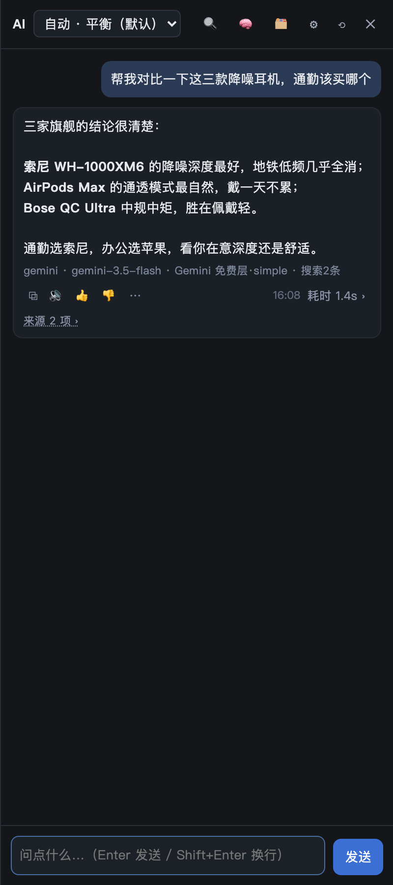

# Sidebrain — AI sidebar for Safari, memory stays on your Mac



**A sidebar for Safari that spends the AI quota you already have.**

- **Uses what you already pay for.** Free tiers first, then a ChatGPT/Claude plan you're already logged into, then your own API key — no second invoice.
- **Memory stays on your disk.** Pages you read and questions you ask live in one file on your Mac; search them by meaning, delete one, or wipe the lot.
- **Early beta, free to test.** The thing we want back is a [bug report](https://github.com/buzzmartglobal-art/sidebrain/issues/new/choose): system version, Safari version, the channel shown in the panel footer, and what you expected.

> 中文说明在下面 [中文](#中文)

---

## Why another sidebar

Most AI sidebars charge a monthly subscription to resell you a model you already pay for, and keep your history on their
servers. Sidebrain is the opposite:

- **You bring the model.** ChatGPT / Claude plans (via the official CLIs already logged in on your Mac), or any API key: Gemini, DeepSeek, Groq, OpenRouter, Cloudflare, local Ollama.
- **No middleman.** Requests go straight from Safari to the provider. Nothing passes through us.
- **No monthly fee.** The free edition is free; the Pro beta is free to test while we finish it.

## Free edition (this repo)

| | |
|---|---|
| Sidebar UI | ✅ Panel with ⇧⌘K, resizable, dark |
| Providers | ✅ Gemini free tier, DeepSeek, Groq, OpenRouter, local Ollama |
| Model choice | Manual pick from a list |
| History | ✅ 8 turns in the current tab |
| Page context | ✅ Reads the current article as context |
| Copy / read aloud / 👍👎 | ✅ |
| Routing, memory, self-check | ❌ Pro beta only (see below) — free to test |

## Install (4 steps, ~3 minutes)

1. Install the free **Userscripts** extension from the Mac App Store
   ([link](https://apps.apple.com/app/userscripts/id1463298887)).
2. In Safari → Settings → Extensions, enable Userscripts, and allow it on all websites
   (or at least the sites you want the sidebar on).
3. Download [`sidebrain.user.js`](./sidebrain.user.js) and save it into the folder the
   extension shows you (Userscripts app → it prints the exact path on first run).
4. Reload the page, press **⇧⌘K** (or click the ✦ button in the corner), open ⚙︎, paste
   **one** API key, save.

You need at least one key. The cheapest useful one is a Gemini API key from
[aistudio.google.com/apikey](https://aistudio.google.com/apikey) — its free tier is
enough for normal daily use.

### Where to get keys

| Provider | Where | Free? |
|---|---|---|
| Gemini | [aistudio.google.com/apikey](https://aistudio.google.com/apikey) | ✅ free tier, per-minute limits |
| Groq | [console.groq.com/keys](https://console.groq.com/keys) | ✅ free tier, no card |
| OpenRouter | [openrouter.ai/keys](https://openrouter.ai/keys) | ✅ ~20 `:free` models |
| DeepSeek | [platform.deepseek.com](https://platform.deepseek.com) | 💰 very cheap, pay as you go |
| Ollama | local, `ollama serve` | ✅ free, offline |

## What Pro adds (beta, free to test)

Pro is the same sidebar plus a small local service (`~/ai-gateway`) that runs on your Mac. It is in beta and free to test
right now — nothing is on sale, and a paid tier may come later.

- **Three-tier routing** — free tiers first, then your subscription quota, then pay-per-token APIs. Falls through automatically when a provider rate-limits you.
- **Multi-key rotation** — several free keys per provider, 429 on one switches to the next instead of failing.
- **Memory** — pages you read are captured locally, searchable in plain language, listable, deletable, one-click wipe with automatic snapshots.
- **Channel self-check** — one button tells you which channel is alive, which is out of quota, which key is wrong.
- **Subscription channels** — uses the official `codex` / `claude` CLI already logged in on your machine. No credentials are stored by us.
- **Free web search** — DuckDuckGo / Bing via the local service, no search API bill.

Known limits of the beta (no native right-hand dock, the local service must be running, subscription channels off by
default, macOS only) are written out at [docs/beta.html](./docs/beta.html).

## Privacy, plainly

- Keys live in Safari's userscript storage on your Mac. They are sent only to the provider you chose.
- No analytics, no telemetry, no account.
- The memory store is a file at `~/ai-gateway/memory/pages.jsonl`. You can read it, delete entries, or wipe it.

## Status

Early beta. Built and tested on macOS 26.5 / Safari 26.5. Bugs are expected; the issue
tracker is the fastest way to get them fixed. Before filing, skim
[docs/beta.html](./docs/beta.html) — it lists what is already known to be broken.

If you use a **subscription channel** you are responsible for how that use lines up with
the provider's terms. Sidebrain only invokes CLIs you installed and logged in yourself; it
does not proxy, resell, or pay for anything on your behalf.

MIT licensed.

---

<!-- For the maintainer: paste these into GitHub → Settings → Topics. 20 max, all lowercase, hyphens not spaces. -->

## Suggested GitHub topics

```
safari-extension
safari-userscript
ai-sidebar
ai-assistant
macos
userscript
llm
byok
local-first
privacy
chatgpt
claude
gemini
ollama
openrouter
```

---

## 中文

**Sidebrain 是一个 Safari 的 AI 侧边栏：用你自己已有的模型额度和 key，记忆只存在你自己电脑上。**

- 不用注册、不上传、不收月费。
- 免费版就是这个仓库里的 `sidebrain.user.js`，手选模型，直连各家 API。
- Pro 版多一个本地小服务：三层自动路由（免费额度 → 订阅额度 → 付费 API）、多把 key 轮换、浏览即记与语义找回、通道自检、订阅通道、免费联网搜索。

### 安装（4 步，约 3 分钟）

1. 从 App Store 装免费的 **Userscripts** 扩展。
2. Safari → 设置 → 扩展，启用 Userscripts，并允许在网站上使用。
3. 把 `sidebrain.user.js` 放进扩展指定的脚本目录（扩展第一次运行会显示路径）。
4. 刷新页面，按 **⇧⌘K** 打开侧边栏，点 ⚙︎ 填一个 key，保存。

最省事的起步是去 [aistudio.google.com/apikey](https://aistudio.google.com/apikey) 拿一把 Gemini 的 key，免费额度足够日常用。

### 说明

- key 只存在本机（Safari 的 userscript 存储），只发给你选的那家。
- 用订阅通道时，怎么用、是否符合你和模型商的协议，由你自己判断并承担；本工具只调用你自己装好、自己登录的命令行工具。
- MIT 许可。
